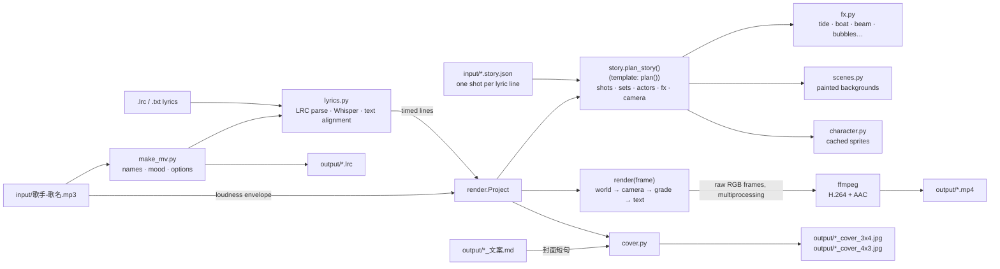

# majiaozhu: animated lyric MVs

Send an MP3 and get back a ready-to-post package: an animated lyric video in the style of the four reference
videos in this repo (box-shaped characters, hand-inked scenes, karaoke subtitles), two covers, and a title with 文案.

| For every song | File | Notes |
|---|---|---|
| Lyric video | `output/<歌手-歌名>.mp4` | 1920×1080, 30 fps, H.264 + AAC, ~2 Mbit/s (≈60 MB for 4 min; long songs get a lower bitrate so files stay under ~85 MB) |
| Portrait cover 3:4 | `output/<name>_cover_3x4.jpg` | 1080×1440, for the vertical feed and profile grid |
| Landscape cover 4:3 | `output/<name>_cover_4x3.jpg` | 1440×1080, for horizontal placements |
| Title + 文案 | `output/<name>_文案.md` | 发布标题, alternative titles, 封面短句 (also printed on the covers), the post text, hashtags |
| Timed lyrics | `output/<name>.lrc` | edit and re-render to fix any lyric |

The default look is **melancholy**: a quiet, evening, "missing someone" mood, the kind of video posted late at night.
It opens at a sunset bus stop and ends in a dark room or a sleeping city.

```bash
pip install -r mvmaker/requirements.txt              # ffmpeg/ffprobe must be on PATH
python3 -m mvmaker.make_mv "input/歌手-歌名.mp3"         # video + both covers (+ .lrc)
```

### Repository layout

```
majiaozhu/
├── 11 蔡蔡-坏女孩.mp4 … 14 蔡蔡-等你下课.mp4   style references (not used by the code)
├── input/                  source songs: <歌手-歌名>.mp3 (+ optional .txt / .lrc lyrics)
├── output/                 everything produced per song (video, covers, 文案, .lrc)
├── mvmaker/                the generator (see "Architecture" below)
│   ├── make_mv.py          command line entry point
│   ├── lyrics.py           lyric sources: LRC / text alignment / Whisper
│   ├── render.py           storyboard, animation, compositing, encoding
│   ├── story.py            storyboard mode: lyric-matched shots, character acts, crowds
│   ├── sets.py             storyboard scenery (sea, island, pier, underwater, storm…)
│   ├── fx.py               animated lyric effects (tide, boat, beam, lightning, bubbles…)
│   ├── scenes.py           background library + mood pools (template mode)
│   ├── character.py        box characters (sprites)
│   ├── cover.py            3:4 and 4:3 covers
│   ├── common.py           canvas, fonts, glow, paper texture helpers
│   └── fonts/              Ma Shan Zheng (titles), Long Cang (lyrics), OFL licence
├── docs/ARCHITECTURE.md    deeper notes on the internals
└── CLAUDE.md               the step-by-step workflow Claude follows when you send an MP3
```

---

## 1. How the reference videos are made

| | 11 坏女孩 | 12 失眠 | 13 天龙八部之宿敌 | 14 等你下课 |
|---|---|---|---|---|
| Length | 4:02 | 3:31 | 4:23 | 4:30 |
| Opening card | title in brush lettering, red underline, singer | brush title, gold underline, singer "Suki刘舒妤" | title in a vertical paper strip on the right | title handwritten on an envelope with a pen |
| Look | flat colours, thick outlines, rain/night, purple neon bar | painted, textured, warm "old town" | snowy night lake, moon, stars | pastel paper-craft school town |
| Lyrics | small yellow text, bottom centre | gold text on a dark tag | – | notebook-paper strip with pink tape, **karaoke fill** |

### Technical specs (all four)
* 1920×1080, **30 fps**, H.264 (yuv420p) at about 1.1–1.8 Mbit/s, AAC 44.1 kHz stereo
* Exported for Douyin (the `vid:` tag in the metadata). The encoder string is `Lavf58.76.100`, the ffmpeg build used by 剪映/CapCut exports, so they were probably finished in 剪映.
* Every video has exactly one audio track, the original song, with no voice-over or sound effects.

### Visual language
1. **Characters are simple boxes.** Each one is a rectangle body with four stick legs, two small block arms and a minimal face (dot eyes, `^ ^`, `> <`, a small mouth, pink blush). You tell characters apart by one accessory (a flower, beanie, cap or fringe of hair) and by body colour. This design is cheap to animate, so one person can make a 4-minute story.
2. **Emotion is shown with symbols**: blue tear streams, a rain cloud over the head, floating hearts, music notes, sparkles, "Zzz".
3. **Flat 2D scenes with thick dark-plum outlines** (never pure black). Lines are slightly wobbly so they look hand-inked. Shading uses flat darker bands.
4. **A paper texture and vignette sit over everything**, so frames look like printed illustrations instead of clean vectors.
5. **Each scene has its own palette, and the palette carries the mood:**
   * present-day sadness uses cold night blues, warm lit windows, street lamps and rain
   * memories and happy flashbacks use warm sepia or pastel daylight (the park bench at sunset in 坏女孩, the classroom in 等你下课)
   * nightlife uses purple, with neon heart and cocktail-glass signs
6. **Ambient motion**: rain, snow, falling petals, dust in lamplight, fireflies, flickering neon, twinkling stars.

### Structure and editing
* 0–5 s: an establishing shot with the **title card** (title, underline, singer).
* After that, **a new shot every 1–2 lyric lines** (about 5–10 s). Shots change on the downbeat where a lyric starts, with short crossfades or simple wipes.
* The story is told literally from the lyrics. Lonely now, a flashback to being happy together, back to lonely.
* The videos are **bookended**: the last shot returns to the opening location (the rainy street in 坏女孩, the bedroom with the desk lamp in 失眠), usually with the character alone.
* Animation is **limited** (cut-out style): walk cycles, body bobbing, slow camera push-ins and pans. There is very little frame-by-frame animation.
* Lyrics show one line at a time at the bottom centre. In 等你下课 the text fills in character by character as it is sung (karaoke). 剪映's "识别歌词" (lyric recognition) feature plus a karaoke text animation produces exactly this.

### Probable original workflow
1. Write a small storyboard from the lyrics, choosing scenes and what the character feels.
2. Draw the backgrounds and character parts as layers (Procreate/Photoshop; 失眠's painted textures may also use AI-generated backgrounds).
3. Animate with keyframes in 剪映 or After Effects: move, bob, swap the face, zoom the camera.
4. Run lyric recognition, fix the text, and apply a subtitle template.
5. Export at 1080p30 and upload to Douyin.

---

## 2. The generator (`mvmaker/`)

`make_mv.py` automates the recipe above:

| Step | What the tool does |
|---|---|
| Title / singer | taken from the MP3 tags, otherwise from the file name (`歌手-歌名.mp3`). Override with `--title` / `--artist`. |
| Lyrics + timing | `--lyrics x.lrc` uses its timings directly. `--lyrics x.txt` (plain lines) gets aligned to the vocals automatically. With no lyrics, the song is transcribed with Whisper. If the voice detector misses the vocals (DJ remixes, heavy beats, live recordings), detected by too few words or less than 60% of the song covered, it retries without it. A `.lrc` file is always written so you can fix wrong words and re-run. |
| Mood | `melancholy` (default), `sad` or `sweet`. Only clearly happy love songs switch to `sweet` automatically. The mood picks the scene pool, the faces and the colour grade. |
| Storyboard (lyric-matched) | `input/<name>.story.json` describes **one shot per 1–2 lyric lines**: where it happens, what the characters do, which effects play. 「一个岛锁住一个人」 is a lone character on a tiny island with the camera pulling out; 「我等的船还不来」 is sitting at the end of a pier while a boat sails away; 「寂寞默默沉没沉入海」 is sinking underwater; 「往事浮上来」 is memory photos floating up. Claude writes it for every song (see "Storyboards" below). Without one, a fallback template mode picks scenes by mood. |
| Scenes | sea and storyboard sets in dusk/night/storm/day palettes: beach, pier, island, underwater, storm at sea, cliff, lighthouse, mountains with a river, spring meadow with blossom trees, snowy northern street, kitchen. Plus the earlier library: sunset bus stop, rainy street, night city, bedroom, snowy lake, neon bar, rooftop, park bench, school street, classroom. All drawn in code in the flat, outlined, paper-textured style. |
| Character acts | stand, walk (including walking away into the distance), sit, back view, holding an umbrella (or sheltering someone else), two in one boat, floating, sinking, dancing, fading away, a scarf, a glowing phone, white hair for old age. Crowds of grey (or colourful) passers-by. Emotes: rain cloud, hearts, notes, sparkles. |
| Lyric effects | tide that washes away footprints and a heart drawn in the sand, waves, storm swell, lightning, a boat passing on the horizon, seagulls, lighthouse beam, light rays, bubbles, seaweed, a cracked heart sinking, memory photos rising, chat bubbles popping from a phone, a calendar shedding pages, a fast-spinning clock, steam from a pot, a warm beam of sunlight, shooting stars, aurora, fireworks. |
| Motion | walk cycles, blinking, bobbing to the music's energy, the lead "singing" (mouth follows vocal loudness), hand-drawn line boil, camera push-ins and pans, crossfades, rain, snow, petals, dust, fireflies, flickering lamps and neon. |
| Text | brush-lettered title card with an animated underline. Notebook-paper karaoke subtitles (`--style paper`, default) or gold-on-dark tags (`--style banner`). |
| Covers | the opening scene re-framed for 3:4 and 4:3, the lead character drawn sharply at cover size, title + singer, and the 封面短句 on paper strips. |
| Output | faststart MP4, H.264 CRF 22 capped at 2.2 Mbit/s (lowered automatically for songs over about 5 minutes, so the file stays under ~85 MB and fits GitHub's 100 MB limit), AAC 192k, ready for Douyin. |

### Commands

```bash
python3 -m mvmaker.make_mv song.mp3 --stills 3,40,90            # a few PNG frames (+ covers) to check the look
python3 -m mvmaker.make_mv song.mp3 --start 30 --length 15      # short preview clip
python3 -m mvmaker.make_mv song.mp3 --lyrics output/song.lrc     # re-render after correcting the lyrics
python3 -m mvmaker.make_mv song.mp3 --covers-only --tagline "那年的雪很大/我一个人跳完了余生"
python3 -m mvmaker.make_mv song.mp3 --seed 7                    # different scene order / characters
python3 -m mvmaker.make_mv song.mp3 --mood sad --style banner   # rainier and more tearful, gold subtitle tags
```

| Option | Meaning |
|---|---|
| `--title`, `--artist` | text on the title card and covers |
| `--lyrics FILE` | `.lrc` (timed) or `.txt` (one lyric line per line) |
| `--no-asr`, `--asr-model` | skip Whisper / choose the model (`large-v3-turbo` default, `small` is faster) |
| `--no-lyrics` | no subtitles |
| `--mood auto/melancholy/sad/sweet` | scene set, expressions and colour grade |
| `--style paper/banner` | subtitle look |
| `--tagline TEXT` | cover line, `/` = line break. Default: the `封面短句：` line in `output/<name>_文案.md` |
| `--covers-only`, `--no-covers` | covers without video / video without covers |
| `--seed N` | reshuffles scenes, characters and camera moves |
| `--stills T1,T2…`, `--start`, `--length` | previews |
| `--crf`, `--workers` | encoder quality, CPU processes |

A 4-minute song takes about 5 minutes to render on 4 CPU cores, plus about 1 minute for transcription.

### The 文案 file

Claude writes `output/<name>_文案.md` for each song (see CLAUDE.md). Format:

```markdown
# 歌名 · 歌手 发布文案
- **发布标题**：…
- **备选标题**：…
- **封面短句**：第一行/第二行        ← printed on both covers
## 文案
…post text, evening/sentimental tone…
## 话题
#歌名 #歌手 #深夜emo …
```

---

## 3. Architecture



### Modules

| Module | Responsibility | Key pieces |
|---|---|---|
| `make_mv.py` | CLI and orchestration | `guess_names` (tags/filename), `guess_mood` (lyric keywords), `read_copy` (封面短句), writes `.lrc`, calls covers and `encode` |
| `lyrics.py` | turning a song into timed `Line`s | `parse_lrc`, `parse_text`, `transcribe` (faster-whisper with VAD fallback, hallucination filter, t2s), `lines_from_stream` (split/merge into subtitle lines), `align_text` (difflib match of your lyrics to the transcription, fills gaps) |
| `render.py` | everything time-based | `audio_features` (energy and beat pulse per frame), `plan` (shot cuts on lyric starts, scene sequence per mood pool, actors, framing, camera), `Particles`, `draw_emote`, `TitleCard`, `Subtitles` (karaoke), `Project.render_world` / `camera` / `render`, `encode` |
| `scenes.py` | backgrounds | one function per scene returns a `Scene` (bg, optional foreground layer, ground line, character slots, glows, stars, particle type, lighting tint). `POOLS` maps mood → opening, middle and flashback scenes |
| `character.py` | the box characters | `Look` (colour + accessory), `sprite(...)` draws one pose (expression, blink, mouth, legs, arms, line-boil variant) and caches it |
| `cover.py` | covers | re-frames the opening scene for 3:4 / 4:3, draws the lead at cover resolution, title + singer + paper-strip tagline |
| `common.py` | drawing toolkit | `Canvas` (2× supersampled, wobbly hand-inked shapes), glows, gradients, `paper_overlay` (texture + vignette + grade), font fallback, tokenising |

### How a frame is made

1. **World layer** (2150×1210, 12% larger than the frame): copy the pre-painted background, add pulsing glows (lamps, neon, moon) driven by the music's energy, twinkle the stars, paste the characters (pose picked from the time and audio), emotes above their heads, then the foreground layer (bench seat, desks, rocks).
2. **Camera**: crop and scale the world (push-in, pull-out, pan, close-up on the lead).
3. **Screen layer**: weather particles, then a crossfade with the neighbouring shot near cuts.
4. **Grade**: multiply by the paper texture, vignette and colour grade.
5. **Text**: title card (first seconds), the current lyric strip with karaoke fill, fade in from and out to black.

Every step is a pure function of the frame number, so frames render in parallel processes and stream into one ffmpeg process in order.

More detail (planning rules, caching, performance, how to add scenes or characters) is in [`docs/ARCHITECTURE.md`](docs/ARCHITECTURE.md).

---

### Storyboards

Each song gets `input/<歌手-歌名>.story.json`. It's plain data: a list of shots, each tied to lyric line indexes (from the `.lrc`):

```json
{"lines": [18], "note": "一个岛锁住一个人",
 "set": "island", "time": "night",
 "cast": [{"who": "hero", "x": 990, "y": 866, "act": "sit", "s": 13, "back": true}],
 "fx": ["waves"], "cam": "pull"}
```

* `set` + `time` (dusk/night/storm/day) pick the scenery;
* `cast` places the hero ("I") and the partner ("you"), or a `crowd`, with an act, face and movement (`x→x1`, `y→y1`, scale `s→s1`, `fade`);
* `fx` lists animated effects with their parameters;
* `cam` is push, pull, pan_left, pan_right, close or static;
* `"from": seconds` makes instrumental shots.

The full field list is in the `mvmaker/story.py` docstring. Complete examples: `input/洋澜一-伤心太平洋.story.json` (48 shots, a sad song at sea) and `input/解忧邵帅-你是人间四月天.story.json` (37 shots, a tender love song).

---

## 4. Limits compared with the hand-made originals

* Everything is drawn by code (no AI image generation), so shots are built from the sets, props, acts and effects that exist. A lyric that needs something new (a train, a letter, a wedding…) means adding it to `sets.py` / `fx.py` first; each is a small function.
* Whisper gets most words right, but not all. Supplying the lyrics as `.txt` or `.lrc` gives exact text.

Fonts: Ma Shan Zheng and Long Cang (SIL Open Font License, `mvmaker/fonts/OFL.txt`).
